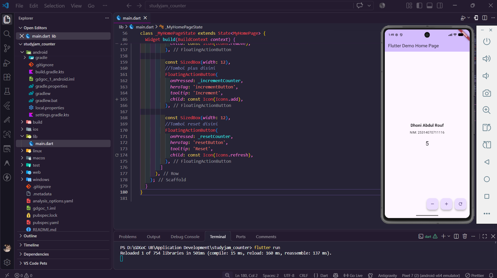

# Study Jam 1 - Counter App

## Deskripsi
Aplikasi penghitung sederhana berbasis Flutter
yang dibuat untuk memenuhi Study Jam Challenge 1
GDG on Campus FILKOM UB.

## Developer
- Nama: Dhoni Abdul Rouf
- NIM: 25314070711116

## Fitur
- Increment (+)
- Decrement (-)
- Reset Counter
- Counter tidak dapat bernilai negatif

## Screenshot Aplikasi

## Teknologi
- Flutter
- Dart